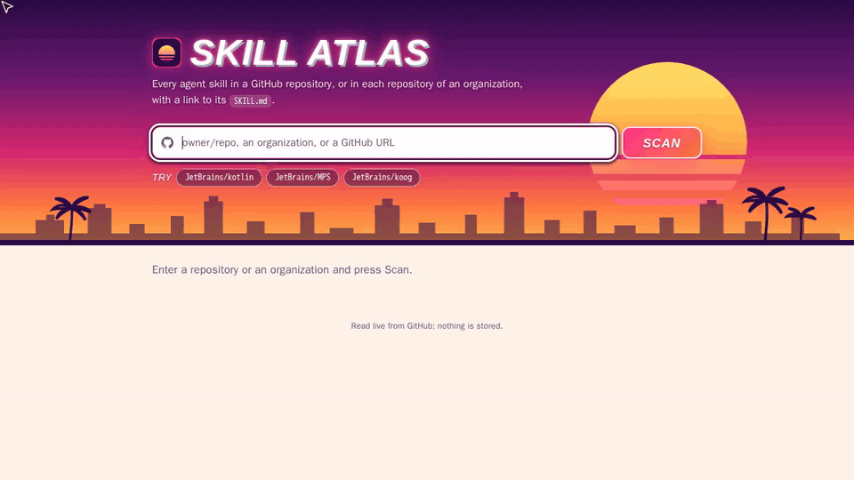

# Skill Atlas

Every agent skill in a repository: `./skill-atlas scan` finds each project skill's `SKILL.md` and prints its name,
description and link.

```console
$ npm ci
$ ./skill-atlas scan https://github.com/JetBrains/kotlin
JetBrains/kotlin · 6 skills
…
build-tools-bump-gradle-api — Bumps the Gradle API version that Kotlin Gradle plugins are compiled against in the Kotlin compiler repository.
  https://github.com/JetBrains/kotlin/blob/5ab6270ab772d113e8ad52ebfcaa0109c522ae00/.claude/skills/build-tools-bump-gradle-api/SKILL.md
…
```

A GitHub organization's URL, `./skill-atlas scan https://github.com/JetBrains`, scans each of its repositories, one by
one; set `GITHUB_TOKEN` for a large one.

`npm start` opens the web view on http://localhost:3000: type a repository or an organization, press Scan. It keeps
what it scanned for 24 hours, so scanning the same repository again does not fetch it from GitHub. **Cluster**
groups the skills that say similar things, by the words of their names and descriptions, and draws them on a map.

Set `GITHUB_TOKEN` for a higher GitHub rate limit. `npm test` runs the tests.

- [spec/](spec/): what it does. [AGENTS.md](AGENTS.md): the definition of done.
- [fixture/](fixture/README.md): a small repository for the tests.
- [qa/](qa/): UI tests, Playwright tests over the mock data, each page compared with its screenshot; `npm run qa`
  ([spec/qa.md](spec/qa.md)).
- [mock/](mock/README.md): mock GitHub data for demos; `npm run mock` serves the web view over it, `npm run demo`
  records [docs/demo.mp4](docs/demo.mp4), a 15-second demo of the web view, and its preview:

  

## Automations

- [.agents/skills/issue-solve/SKILL.md](.agents/skills/issue-solve/SKILL.md): an issue labeled "Delegated to AI" gets a branch, a fix and a Pull
  Request, with a demo video when the web view changes, its preview playing in the description; it merges, or asks the AI operator about blocking review findings. With the label `DelegatedToAI` it
  addresses them and updates the PR instead, waiting up to 10 minutes for each new review, at most 5 review rounds.
- [.agents/skills/code-review/SKILL.md](.agents/skills/code-review/SKILL.md): reviews a Pull Request with inline comments and a verdict; when the
  issue has the label `DelegatedToAI`, after Request Changes it waits up to 10 minutes for new commits and reviews again,
  at most 5 review rounds.
- [.agents/skills/qa/SKILL.md](.agents/skills/qa/SKILL.md): runs the UI tests in [qa/](qa/), reads a failing screenshot and its difference, takes
  new screenshots for a change meant to show, and adds a test for a new case in the spec.
- [.agents/skills/human/SKILL.md](.agents/skills/human/SKILL.md): human-in-the-loop: when an issue is vague or the feature is big, asks for
  clarification or confirmation of the plan in the Slack channel `ai-workshop-munich-2026-os` (with `SLACK_BOT_TOKEN`),
  waits up to 10 minutes for a reply in the thread, and asks on the issue instead when no one answers.
- [.agents/skills/red-agent/SKILL.md](.agents/skills/red-agent/SKILL.md): a QA engineer hunting for bugs in the CLI and the web view, at most 5
  attempts; makes each bug granular with the shortest way to reproduce it, scores them, files the most important one not
  among the open issues, and announces it in the Slack channel `ai-workshop-munich-2026-os`.
- [.agents/skills/changes/SKILL.md](.agents/skills/changes/SKILL.md): logs each meaningful change in [CHANGES.md](CHANGES.md), not quick fixes or
  small refactorings.
